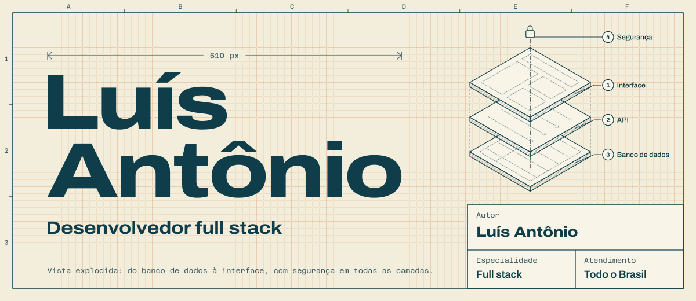
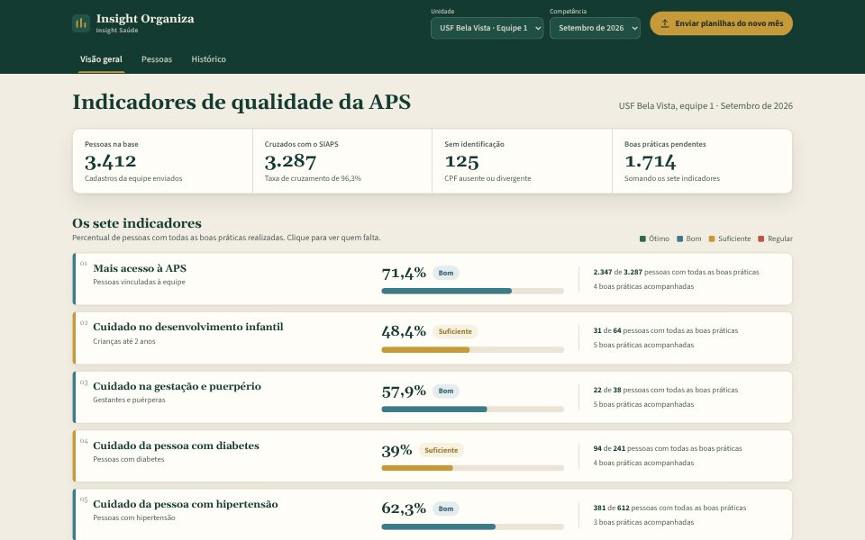
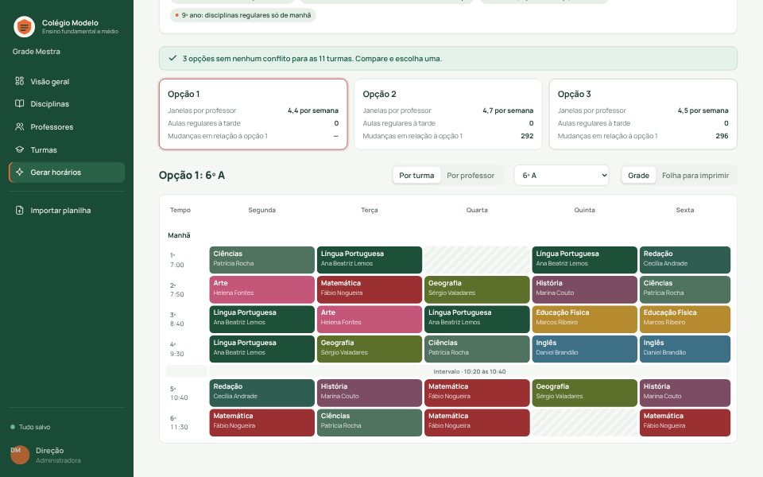
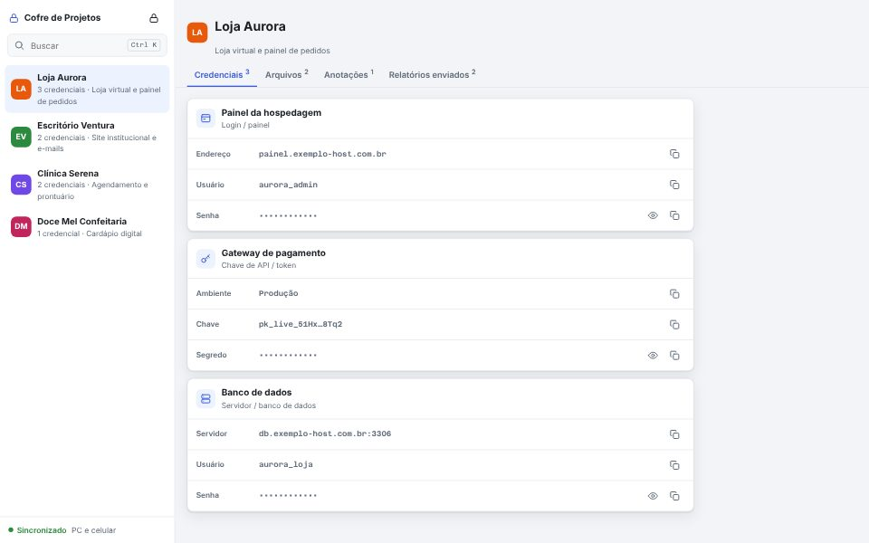
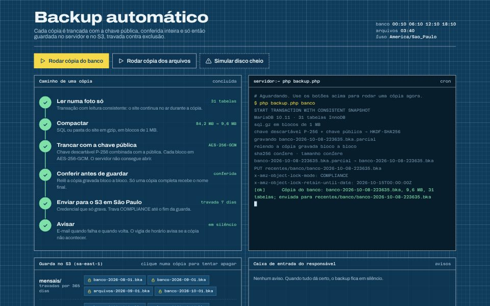
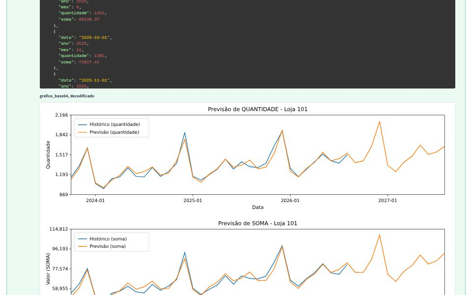

<a href="https://luisantonio-dev.vercel.app">
  <picture>
    <source media="(prefers-color-scheme: dark)" srcset="assets/cabecalho-escuro.svg">
    
  </picture>
</a>

Construo sistemas web, sites, landing pages, lojas virtuais, automações e agentes de IA. Do banco de dados à interface, com segurança de verdade e telas que se explicam sozinhas.

**[Ver o portfólio](https://luisantonio-dev.vercel.app)** · **[Conversar no WhatsApp](https://wa.me/5573981676389?text=Ol%C3%A1%2C%20Lu%C3%ADs!%20Vi%20seu%20perfil%20no%20GitHub%20e%20quero%20conversar%20sobre%20um%20projeto.)**

## Projetos

Sistemas em uso, landing pages e rotinas que rodam sozinhas. A imagem de cada projeto abre o estudo de caso no portfólio, com o problema, a solução e as decisões técnicas.

### Insight Organiza

PLATAFORMA POR ASSINATURA · NO AR

Transforma as planilhas do SIAPS em painéis dos indicadores da Atenção Primária, pessoa por pessoa. As planilhas são lidas no navegador, e nomes, CPF e CNS ficam cifrados com uma chave por organização.

<code>PHP&nbsp;8</code> <code>MySQL</code> <code>Asaas</code> <code>Auth0</code> <code>GitHub&nbsp;Actions</code>

[Estudo de caso](https://luisantonio-dev.vercel.app/projetos/insight-organiza/) · [insightorganiza.com.br](https://insightorganiza.com.br)

 

### Grade Mestra

SISTEMA · EM USO POR UM COLÉGIO

Monta a grade de horários de um colégio inteiro respeitando regras que geradores genéricos não conhecem. O motor roda num Web Worker, e a tela continua respondendo enquanto ele testa combinações.

<code>Next.js</code> <code>React</code> <code>TypeScript</code> <code>Supabase</code> <code>Web&nbsp;Workers</code>

[Estudo de caso](https://luisantonio-dev.vercel.app/projetos/grade-mestra/)

 

### Cofre de Projetos

APLICATIVO INSTALÁVEL · USO PRÓPRIO

Cofre de senhas e arquivos por cliente, criptografado no aparelho e sincronizado entre PC e celular. A nuvem só recebe o cofre já trancado, e nem o servidor consegue ler.

<code>Web&nbsp;Crypto</code> <code>AES-256-GCM</code> <code>Argon2id</code> <code>PWA</code> <code>Supabase</code>

[Estudo de caso](https://luisantonio-dev.vercel.app/projetos/cofre-de-projetos/)

 

### Backup Automático

ROTINA AGENDADA · PROJETO INDEPENDENTE

Cópias criptografadas de sites PHP que o próprio servidor não consegue abrir, guardadas fora da hospedagem. Cada cópia é conferida antes de ganhar nome e fica travada contra exclusão.

<code>PHP&nbsp;8</code> <code>MySQL</code> <code>OpenSSL</code> <code>AWS&nbsp;S3</code> <code>Object&nbsp;Lock</code>

[Estudo de caso](https://luisantonio-dev.vercel.app/projetos/backup-automatico/)

 

### Previsão de Vendas

API · CÓDIGO ABERTO

API que recebe o histórico de vendas de uma rede e prevê quantidade e faturamento de cada loja. Quando o arquivo tem algum problema, a resposta diz o que corrigir.

<code>Python</code> <code>FastAPI</code> <code>Prophet</code> <code>pandas</code> <code>matplotlib</code>

[Estudo de caso](https://luisantonio-dev.vercel.app/projetos/previsao-de-vendas/) · [Código](https://github.com/tonsellmann/api-previsao-vendas)

 

### Primícia Pós-graduação

LANDING PAGE · NO AR

Landing page de vendas de uma pós-graduação on-line em Saúde Coletiva, da primeira dúvida até a matrícula. Um arquivo só, com pouco mais de 1 KB de JavaScript.

<code>HTML</code> <code>CSS</code> <code>JavaScript</code> <code>WebP</code>

[Estudo de caso](https://luisantonio-dev.vercel.app/projetos/posprimicia/) · [posprimicia.com.br](https://posprimicia.com.br)

 

### Também no portfólio

Lá também estão a landing page da [OperaLume](https://luisantonio-dev.vercel.app/projetos/operalume/), minha marca de sites, automações e software sob medida, e doze projetos conceito: modelos completos feitos para marcas inventadas.

- **IA e chatbots.** [Exordia](https://luisantonio-dev.vercel.app/projetos/exordia/) redige petições iniciais a partir de peças que deram certo, citando as fontes. [Atendente Alva](https://luisantonio-dev.vercel.app/projetos/atendente-alva/) atende no WhatsApp e marca consultas na agenda real.
- **Automação.** [Esteira de Leads](https://luisantonio-dev.vercel.app/projetos/esteira-de-leads/) junta os contatos, qualifica com IA, registra no CRM e responde no WhatsApp em menos de um minuto.
- **Sistemas.** [Balcão](https://luisantonio-dev.vercel.app/projetos/balcao-gestao-de-pedidos/), painel de pedidos com quadro de produção, estoque e indicadores.
- **Sites.** [Alva Odontologia](https://luisantonio-dev.vercel.app/projetos/alva-odontologia/), [Talo Pilates](https://luisantonio-dev.vercel.app/projetos/talo-pilates/), [Jaqueira Cozinha Baiana](https://luisantonio-dev.vercel.app/projetos/jaqueira-cozinha-baiana/), [Costa Ampla Imóveis](https://luisantonio-dev.vercel.app/projetos/costa-ampla-imoveis/) e [Lastro Advocacia](https://luisantonio-dev.vercel.app/projetos/lastro-advocacia/).
- **Lojas virtuais.** [Cabruca Chocolates](https://luisantonio-dev.vercel.app/projetos/cabruca-chocolates/), [Aratu Moda Praia](https://luisantonio-dev.vercel.app/projetos/aratu-moda-praia/) e [Roçado Orgânicos](https://luisantonio-dev.vercel.app/projetos/rocado-organicos/).

## Como trabalho

1. **Entender as regras.** Antes de desenhar, descubro as regras que só quem vive o problema conhece. Na Grade Mestra, foram as aulas geminadas que só começam nos tempos 1, 3 ou 5.
2. **Desenhar o caminho.** Cada tela precisa dizer o que fazer em seguida. Desenho o fluxo inteiro, inclusive os erros, antes de escrever a primeira linha.
3. **Construir com prova.** Testes automáticos para o que não pode quebrar: criptografia, cobrança, regras de negócio. Cada envio ao GitHub passa por verificação.
4. **Publicar e vigiar.** Publicação com backup e botão de voltar, alarmes quando algo para de funcionar e manuais para quem vai operar depois.

## Ferramentas

| Camada | O que uso nos projetos |
| --- | --- |
| Interface | TypeScript, JavaScript, React, Next.js, Astro, HTML e CSS |
| Servidor e API | Node.js, PHP 8 e Python com FastAPI |
| Banco de dados | PostgreSQL com Supabase, MySQL e MariaDB |
| Segurança | AES-256-GCM, Argon2id, Auth0, Supabase Auth e OpenSSL |
| Pagamentos | Asaas, com Pix Automático, cartão e assinatura |
| IA e automação | Agentes de IA, consulta a documentos (RAG), n8n e API oficial do WhatsApp |
| Dados | pandas, Prophet e matplotlib |
| Operação | Vercel, AWS S3, cPanel, GitHub Actions e rotinas com cron |

A lista completa, camada por camada, está nas [especificações do portfólio](https://luisantonio-dev.vercel.app/#especificacoes).

## Contato

**Tem um sistema para tirar do papel?** Conte pelo WhatsApp o que você precisa. A primeira conversa serve para entender o problema. O orçamento vem depois, com prazo e escopo por escrito.

**[Conversar no WhatsApp](https://wa.me/5573981676389?text=Ol%C3%A1%2C%20Lu%C3%ADs!%20Vi%20seu%20perfil%20no%20GitHub%20e%20quero%20conversar%20sobre%20um%20projeto.)** · **[Ver o portfólio](https://luisantonio-dev.vercel.app)**
